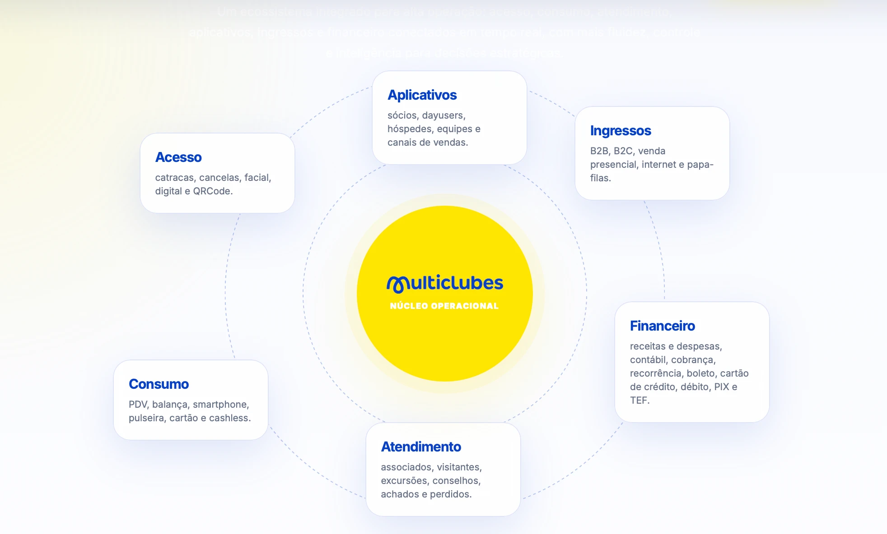

# Referências do site institucional

> Origem: [site.multiclubes.com.br](https://site.multiclubes.com.br). O site não é referência de design system; daqui saem só textos e peças que valem guardar.

## Texto institucional

Texto oficial de apresentação da empresa. Use como está em materiais, documentação e telas de "sobre":

> A Multiclubes desenvolve soluções integradas de software e hardware para clubes, parques e atrações, conectando gestão, operação e experiência em um ecossistema completo.

## O que virou componente no Mosaico

| Peça do site | Componente | O que ficou |
| --- | --- | --- |
| Seção "Prova de mercado", com "CLIENTES" gigante atrás | `BackdropText` | Só a palavra de fundo, com qualquer texto |
| Cartão da campanha "Suba o nível" | `BrandCard` | O "m" da marca cortado nos cantos, nas cores do kit; saíram mascote, logo e texto da temporada |
| Painel do AcessoMenu, com degradê amarelo claro | `GradientPanel` | Só a superfície com o degradê |

## Ecossistema "Sol" (fora do Mosaico)

Diagrama específico da apresentação da empresa, por isso não entra no kit. Fica guardado para landing pages e materiais comerciais.

**Estrutura:** um círculo amarelo central (`highlight`, com halo suave) com a logo e o rótulo "Núcleo operacional". Em volta, dois anéis tracejados em azul claro e seis cartões brancos (raio grande, sombra suave, título em `primary`, descrição em `muted-foreground`) distribuídos ao redor.

**Conteúdo dos cartões:**

| Área | Descrição |
| --- | --- |
| Acesso | catracas, cancelas, facial, digital e QRCode. |
| Aplicativos | sócios, dayusers, hóspedes, equipes e canais de vendas. |
| Ingressos | B2B, B2C, venda presencial, internet e papa-filas. |
| Financeiro | receitas e despesas, contábil, cobrança, recorrência, boleto, cartão de crédito, débito, PIX e TEF. |
| Atendimento | associados, visitantes, excursões, conselhos, achados e perdidos. |
| Consumo | PDV, balança, smartphone, pulseira, cartão e cashless. |

**Título da seção (parcialmente visível no print):** um ecossistema integrado para alta operação: acesso, consumo, atendimento, aplicativos, ingressos e financeiro conectados em tempo real, com mais fluidez, controle e inteligência para decisões estratégicas.

**Se for implementar:** no celular, troque o círculo por uma lista vertical (núcleo no topo, cartões em coluna); os anéis e a disposição radial só funcionam a partir do desktop.
